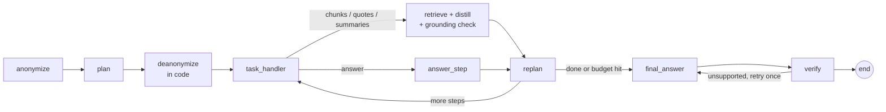
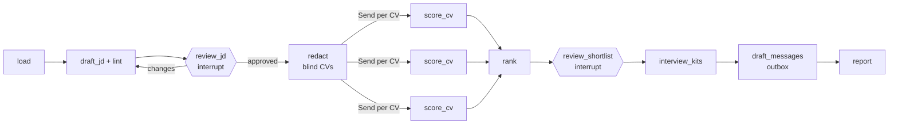
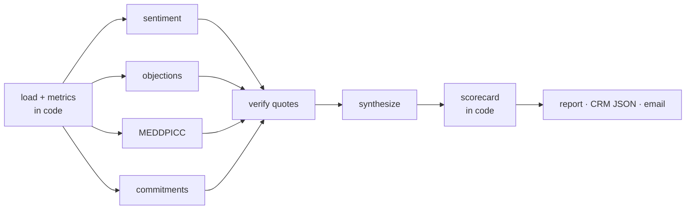

# GenAI Agents — rebuilt for practice

Three projects from [NirDiamant/GenAI_Agents](https://github.com/NirDiamant/GenAI_Agents), rebuilt from scratch in
Python + LangGraph, renamed, and extended with production-style features.

| Project | Rebuilt from | What it does |
|---|---|---|
| **GroundTruth** | #45 Controllable RAG Agent | Answers multi-hop questions from your documents, with checked citations, and says "I don't know" when the documents don't say |
| **TalentScout** | #46 HR AI Assistant | Hiring pipeline: job description → blind CV screening → shortlist → interview kits → drafted emails, with human approvals |
| **DealPulse** | #28 Sales Call Analyzer | Sales call transcript or audio → coaching scorecard, MEDDPICC, objections, CRM update JSON, follow-up email, team report |

All three share `agentkit/`: one LLM interface with three backends, plus run tracing.

## Setup

```bash
cd ~/Documents/AIPrep/genai-agents-practice
uv sync                      # add --extra audio for DealPulse audio transcription
```

Pick a model (all three projects use the same setting):

| `AGENT_LLM_PROVIDER` | Uses | Needs |
|---|---|---|
| `claude` (default when `ANTHROPIC_API_KEY` is set) | `claude-opus-5-5` (override with `CLAUDE_MODEL`) | `ANTHROPIC_API_KEY` |
| `ollama` (default otherwise) | `gpt-oss:120b-cloud` (override with `OLLAMA_MODEL`) | Ollama running locally |
| `fake` | scripted responses | nothing — used by the tests |

## Run

```bash
# GroundTruth
uv run python -m groundtruth ask "Which account manager owns the customer whose outage was caused by firmware 4.2, and when does it renew?"
uv run python -m groundtruth ask --corpus ~/some/folder/of/pdfs "your question"
uv run python -m groundtruth eval            # golden set -> runs/groundtruth-eval.md

# TalentScout (stops at each review; Ctrl+C at a review and `resume` later)
uv run python -m talentscout run --thread demo
uv run python -m talentscout resume --thread demo

# DealPulse
uv run python -m dealpulse analyze dealpulse/sample_calls/halden_renewal.txt
uv run python -m dealpulse batch dealpulse/sample_calls        # + runs/dealpulse/team-report.md
uv run python -m dealpulse transcribe call.m4a --rep "Priya Shah" --account "Acme"   # needs --extra audio

# Offline tests (no model calls)
uv run pytest -q
```

Everything a run produces goes to `runs/` (reports, traces as JSONL, outbox, CRM JSON).

---

## GroundTruth (from #45 Controllable RAG Agent)



| Original | Rebuild |
|---|---|
| Answers without verifiable sources | Every extract keeps its passage id; answers must cite ids; code drops ids that were never retrieved |
| LLM checks whether distilled text is grounded | Code checks word overlap between each extract and its source passage (cheap, deterministic); invented extracts are rejected |
| Plan/replan loop could run forever | `--max-steps` budget; then it answers from what it found or abstains |
| — | Final answer verification: an unsupported answer is sent back once, then downgraded to an honest abstain |
| LLM de-anonymises the plan | String replacement in code |
| FAISS + OpenAI embeddings | BM25 (pure Python) over 3 stores, with query rewrites merged by Reciprocal Rank Fusion; works on any folder of .md/.txt/.pdf; summaries cached by content hash |
| Ragas notebook | `eval` command: LLM-judge correctness, source recall (code), abstain accuracy → markdown report |

Sample data is a fictional company (`sample_corpus/`) whose facts are spread across files, so every golden question needs 2–3 lookups.

## TalentScout (from #46 HR AI Assistant)



| Original | Rebuild |
|---|---|
| Scrapes LinkedIn with a session cookie, auto-sends messages | Reads a folder of CVs; writes drafted emails to `outbox/`; nothing is sent |
| Score parsed from free text with a regex | Structured rubric (weights in `job.yaml`); weighted total, must-have knockouts and shortlist computed in code |
| — | **Blind screening**: name, contact block, DOB, age, gender, marital status, nationality, religion and pronouns removed in code before scoring; names come back only after shortlist approval. A test asserts no name reaches the scorer |
| — | **Evidence check**: every criterion needs CV quotes; code confirms each quote is in the CV, else the score is capped at 2 and flagged |
| One CV at a time | Parallel scoring with LangGraph `Send` |
| `NodeInterrupt`, in-memory | `interrupt()` + SQLite checkpointer: stop at a review, resume later by thread id |
| — | Inclusive-language lint on the job description; interview kits aimed at each candidate's gaps |

## DealPulse (from #28 Sales Call Analyzer)



| Original | Rebuild |
|---|---|
| One CrewAI agent, one prompt, free-form JSON | Four specialist analysers in parallel (fan-out/fan-in), each with a typed schema |
| "Call engagement" guessed by the LLM | Talk ratio, questions, longest monologue measured from the transcript |
| Findings not checked | Each finding cites a turn id + quote; code checks the quote is in that turn and drops it otherwise |
| "Agent effectiveness score" from the LLM | Deterministic 0–100 scorecard (discovery, objection handling, talk balance, next steps) |
| — | MEDDPICC qualification, risk flags, recommended stage, **CRM update JSON** |
| — | Follow-up email draft; numbers/dates in it that were never said on the call are flagged "check before sending" |
| — | `batch` mode → per-rep team report and objection themes |
| Paid OpenAI Whisper API | Local faster-whisper (ffmpeg decode); LLM labels rep vs customer |

---

## Practice ideas

1. **GroundTruth** — add dense embeddings as a 4th ranking in the RRF fusion and check whether `eval` improves; add a question that needs arithmetic across three documents.
2. **TalentScout** — run each CV twice and flag candidates whose scores differ by more than 0.5 (consistency check); add a "structured reference check" step with its own interrupt.
3. **DealPulse** — compare the same call scored by Claude vs Ollama and measure agreement per scorecard component; add a "deal health over time" view across several calls for one account.
4. **All** — swap `CLAUDE_MODEL` between Opus, Sonnet and Haiku and compare eval accuracy against the cost printed at the end of each run.
