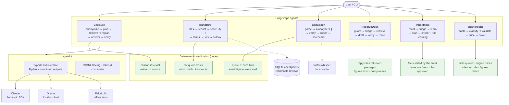

# GenAI Agents — Verified

[](https://github.com/ChandraAINEW26/GenAI_Agents_Verified/actions/workflows/tests.yml)


**Six production-style GenAI agents built on LangGraph, where the LLM proposes and code verifies.**
Every answer, score and finding carries evidence from the source material, deterministic code checks that
evidence, and anything that fails the check is rejected rather than shown as fact.

| Agent | Domain | What it does | Headline result |
|---|---|---|---|
| **[CiteSure](citesure/)** | Knowledge / RAG | Answers multi-step questions from your documents with verified citations, and abstains when the documents don't say | 6/6 and 5/6 on two golden-set runs; never answered the unanswerable question |
| **[BlindHire](blindhire/)** | HR / recruiting | Drafts the job description, screens anonymised CVs against a weighted rubric with quoted evidence, and stops for human approval | Same shortlist across runs; no name or gender label ever reaches the scorer (tested) |
| **[CallCoach](callcoach/)** | Sales | Turns a call transcript or audio into a coaching scorecard, MEDDPICC, CRM update and follow-up email | Strong call 94–100, weak renewal call 32–38 with high risk |
| **[ResolveDesk](resolvedesk/)** | Customer support | Answers tickets from a help centre and account record with checked citations; redacts card data; escalates with a handoff note | 23/23 checks on 10 tickets, incl. injection and security cases |
| **[InboxMind](inboxmind/)** | Productivity | Triages and drafts email, and learns from your corrections through reviewable, versioned rules | 50% → 100% on held-out emails after 6 corrections |
| **[QuoteRight](quoteright/)** | Insurance | Classifies a business from free text, prices it with a deterministic engine, applies underwriting rules | 18/18 checks on 7 submissions; injection cannot move the price |

---

## System architecture



`⏸` = human approval (LangGraph `interrupt`), `∥` = parallel branches, `⟲` = loop. Detailed design:
**[docs/ARCHITECTURE.md](docs/ARCHITECTURE.md)**.

## What each agent demonstrates

<table>
<tr><th>CiteSure</th><th>BlindHire</th><th>CallCoach</th></tr>
<tr valign="top"><td>

- Plan-and-execute agent with re-planning
- Entity anonymisation before planning
- 3 retrieval stores, BM25 + Reciprocal Rank Fusion
- Extract grounding check in code
- Citation validation and answer self-verification
- Step budget, stall detection, honest abstain
- Golden-set evaluation harness

</td><td>

- Human-in-the-loop with `interrupt()`
- Durable state with SQLite; quit and resume
- Dynamic fan-out with `Send`
- PII and protected-attribute redaction
- Evidence-checked rubric scoring
- Deterministic ranking and knockouts
- Inclusive-language lint, outbox instead of auto-send

</td><td>

- Static fan-out / fan-in (4 analysers)
- Measured conversation metrics
- Quote-in-turn verification
- MEDDPICC qualification
- Deterministic 0–100 scorecard + risk flags
- CRM update JSON and team report
- Local audio: ffmpeg + faster-whisper

</td></tr>
</table>

<table>
<tr><th>ResolveDesk</th><th>InboxMind</th><th>QuoteRight</th></tr>
<tr valign="top"><td>

- Knowledge-grounded replies with citations
- Luhn-checked card and secret redaction
- Prompt-injection tripwire
- Written escalation policy with reasons
- Handoff notes, queues, SLA acknowledgement
- Figure verification of replies

</td><td>

- Semantic, episodic and procedural memory in SQLite
- Corrections become reviewable rules
- Rule preview before approval; retire, never delete
- Rules applied by code before the LLM
- Calendar-checked drafts, never sent
- Measured learning on held-out emails

</td><td>

- Deterministic Decimal rating engine
- Facts accepted only with a real quote
- Classification validated in code and by a grader
- Underwriting rules in YAML (decline / refer / quote)
- Injection cannot change the price
- `rate` command: instant what-if, no LLM

</td></tr>
</table>

## Quick start

```bash
git clone https://github.com/ChandraAINEW26/GenAI_Agents_Verified.git
cd GenAI_Agents_Verified
uv sync                          # add --extra audio for CallCoach audio transcription
uv run pytest -q                 # 41 offline tests, no model needed
```

Choose a model with one environment variable:

| `AGENT_LLM_PROVIDER` | Model | Needs |
|---|---|---|
| `claude` (default when `ANTHROPIC_API_KEY` is set) | `claude-opus-5-5` (override with `CLAUDE_MODEL`) | `ANTHROPIC_API_KEY` |
| `ollama` (default otherwise) | `gpt-oss:120b-cloud` (override with `OLLAMA_MODEL`) | [Ollama](https://ollama.com) running locally |
| `fake` | scripted responses | nothing |

Run the agents:

```bash
uv run python -m citesure ask "Which account manager owns the customer whose outage was caused by firmware 4.2, and when does that customer's contract renew?"
uv run python -m citesure eval

uv run python -m blindhire run --thread demo          # stops for your approval twice
uv run python -m blindhire resume --thread demo

uv run python -m callcoach batch callcoach/sample_calls
uv run python -m callcoach transcribe call.m4a --rep "Priya Shah" --account "Acme"

uv run python -m resolvedesk batch
uv run python -m inboxmind learn-demo
uv run python -m quoteright batch
```

Outputs (reports, traces, outbox, CRM JSON) are written to `runs/`. Sample outputs from real runs are in
**[docs/examples/](docs/examples/)**.

## Results

All numbers below come from real runs with `gpt-oss:120b-cloud` on the bundled fictional data.

**CiteSure** — golden-set evaluation ([report](docs/examples/citesure-eval.md))

| Run | Accuracy | Source recall | Abstain accuracy | Avg. steps |
|---|---|---|---|---|
| 1 | 6 / 6 | 100% | 100% | 2.2 |
| 2 | 5 / 6 | 83% | 83% | 2.3 |

The miss in run 2 was an over-cautious abstain on a "no" answer, never a wrong fact. Two bugs found by earlier
evaluation runs (facts overwriting each other, repeated fruitless lookups) are fixed and covered by regression tests.

**BlindHire** — Senior AI Engineer role, 5 CVs ([report](docs/examples/blindhire-report.md))

| Candidate | Weighted /5 | Must-haves | Decision |
|---|---|---|---|
| C-01 | 4.90–5.00 | all met | Interview |
| C-02 | 4.00–4.50 | all met | Interview |
| C-04 | 2.60 | under 3 yrs Python | Decline |
| C-05 | 1.90–2.30 | no production, no cloud | Decline |
| C-03 | 1.10–1.20 | no Python | Decline |

Ranges across three runs; the ranking and decisions were identical every time.

**CallCoach** — 3 calls, 2 reps ([team report](docs/examples/callcoach-team-report.md))

| Rep | Calls | Avg score | Talk ratio | Questions / call |
|---|---|---|---|---|
| Priya Shah | 2 | 85–90 | 52% | 6.0 |
| Ravi Menon | 1 | 32–38 | 64% | 0.0 |

Ranges across four runs.

## Repository layout

```text
.
├── agentkit/            shared LLM interface (Claude, Ollama, Fake), tracing, BM25/RRF, figure and injection checks
├── citesure/            plan-and-execute RAG agent, index, evaluation, sample corpus, golden set
├── blindhire/           hiring workflow, redaction, sample job and CVs
├── callcoach/           call pipeline, transcript parser, audio transcription, sample calls
├── resolvedesk/         support agent, input guard, sample knowledge base, accounts, tickets
├── inboxmind/           email agent, SQLite memory, sample inbox and calendar
├── quoteright/          quoting agent, rating engine, sample categories, rules, submissions
├── tests/               offline tests for all three agents
├── docs/
│   ├── ARCHITECTURE.md  shared design, patterns, trade-offs
│   └── examples/        real outputs: eval report, screening report, call reports, CRM JSON
└── .github/workflows/   CI: offline tests on every push
```

## Tech stack

Python 3.12 · LangGraph (StateGraph, Send, interrupt, SqliteSaver) · Anthropic SDK (structured outputs, effort,
refusal fallbacks) · Ollama · Pydantic v2 · faster-whisper · ffmpeg · pypdf · Rich · pytest · uv · GitHub Actions

## Roadmap

- CiteSure: dense embeddings as a fourth ranking in the fusion; larger golden set
- BlindHire: double-scoring consistency check; reference-check step with its own approval
- CallCoach: deal health across several calls for one account; Claude vs Ollama agreement study
- All: LangSmith / OpenTelemetry export of the JSONL traces

## Author

**Chandra Yelleti** — AI Solutions Architect · [github.com/ChandraAINEW26](https://github.com/ChandraAINEW26)

## Acknowledgements

The project ideas come from six tutorials in
[NirDiamant/GenAI_Agents](https://github.com/NirDiamant/GenAI_Agents) (Controllable RAG Agent, HR AI Assistant,
Sales Call Analyzer, Customer Support Agent, Memory-Enhanced Email Agent, Contextual Quoting System). The code, design and features here are an independent implementation.

## License

[MIT](LICENSE)
