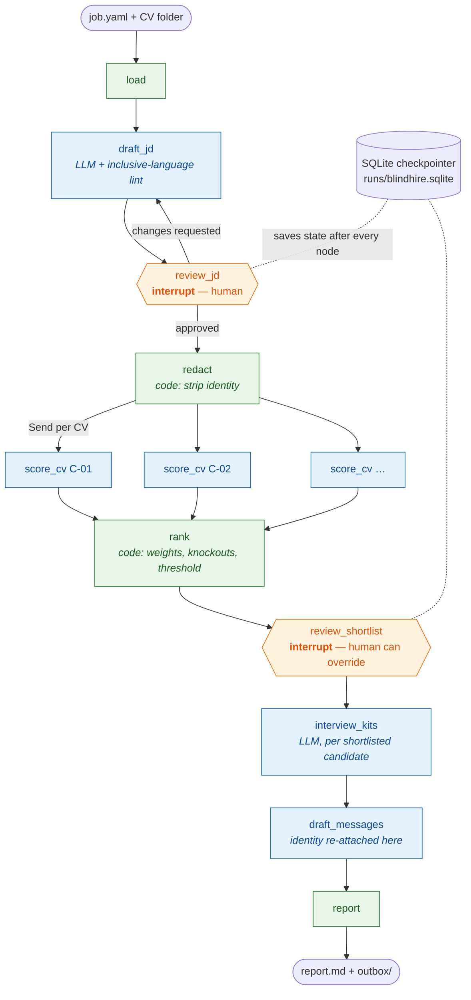
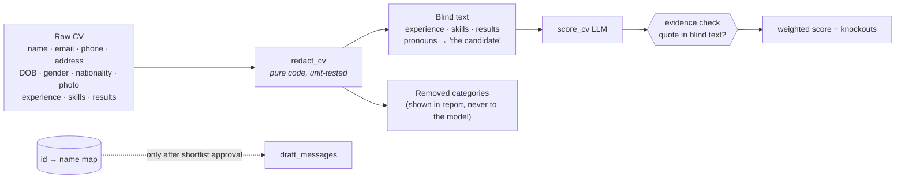
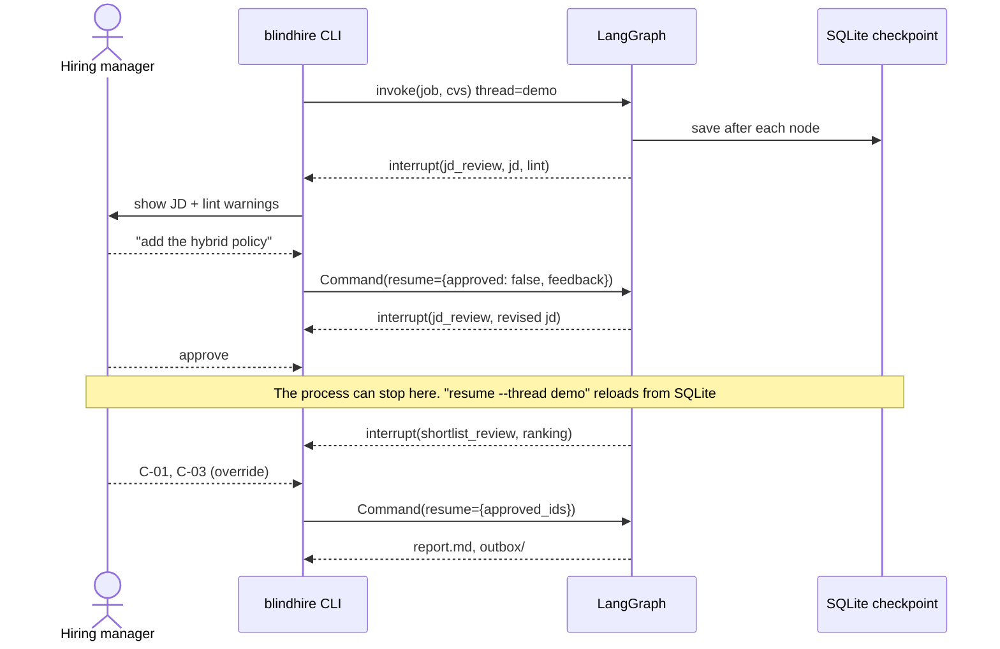

# BlindHire — blind CV screening with human approvals

> A hiring pipeline that drafts the job description, screens CVs with the candidate's identity hidden, scores them
> against a weighted rubric with quoted evidence, and stops for a human at every decision that matters. Nothing is
> ever sent automatically.

**Stack:** LangGraph with `interrupt()` + SQLite checkpointing · parallel `Send` fan-out · Pydantic structured outputs · Claude or Ollama

---

## The problem

Automated CV screening carries two well-known risks:

1. **Bias.** If the model sees names, gender, age, photos or nationality, those can influence the score.
2. **Unverifiable scores.** "7/10, good fit" gives a recruiter nothing to check, and a model can credit experience the CV never mentions.

BlindHire hides identity **in code before any model call**, requires a quote from the CV for every score, checks
each quote, and computes the final ranking from the rubric in code. Humans approve the job description and the
shortlist, and can override either.

## Features

| Feature | How it works |
|---|---|
| Blind screening | `redact.py` removes the name, the whole contact block, email, phone, links, DOB, age, gender, marital status, nationality, religion and address, and replaces gendered pronouns. The scorer receives only an anonymous id and the redacted text |
| Evidence-checked rubric | Each criterion (skills, experience, impact, communication) needs CV quotes; a criterion scored above 2 without a verifiable quote is capped at 2 and flagged |
| Must-have knockouts | Each must-have needs a quote; "met" without a real quote counts as not met |
| Deterministic ranking | Weighted total = Σ weight × score from `job.yaml`; threshold and shortlist size applied in code |
| Parallel scoring | One LangGraph `Send` per CV |
| Durable human-in-the-loop | `interrupt()` at JD review and shortlist review; state saved to SQLite after every step, so you can quit at a review and `resume` later |
| Inclusive-language lint | Flags wording such as "rockstar", "young", "digital native" or gendered pronouns in the JD |
| Tailored interview kits | 6 structured questions per shortlisted candidate, aimed at that candidate's gaps, each with "what a strong answer includes" |
| Outbox, not auto-send | Invite and decline emails are drafted to `outbox/`; identity is re-attached only after the shortlist is approved |
| Audit report | Ranking, per-criterion scores with quotes, what was hidden from the scorer, interview kits, approved JD |

## Architecture

### Workflow graph



### What the scorer can and cannot see



### Scoring, step by step

```text
for each criterion c in the rubric:
    quotes   = LLM evidence for c, stripped of quotation marks
    verified = [q for q in quotes if q appears in the blind CV (normalised substring or ≥80% word overlap)]
    score_c  = LLM score, but capped at 2 if score > 2 and verified is empty

weighted = Σ rubric_weight[c] × score_c                (out of 5)
must_have_met = LLM says met AND its quote is verified
knocked_out   = any must-have not met
shortlist     = top N by weighted, not knocked out, weighted ≥ threshold
```

### Human-in-the-loop and resume



## Results on the sample data

Five fictional CVs for a Senior AI Engineer role (rubric: skills 0.4, experience 0.3, impact 0.2, communication 0.1; threshold 3.2):

| Candidate | Profile | Weighted /5 | Must-haves | Decision |
|---|---|---|---|---|
| C-01 | 7 yrs Python, shipped RAG + LangGraph agent, eval gates, AWS | 4.90–5.00 | all met | Interview |
| C-02 | 8 yrs Python backend, GKE/Kubernetes, RAG prototype in pilot | 4.00–4.50 | all met | Interview |
| C-04 | 2 yrs, shipped a RAG bot on Azure | 2.60 | under 3 yrs Python | Decline |
| C-05 | ML researcher, papers, no production or cloud work | 1.90–2.30 | 3 missing | Decline |
| C-03 | Senior Java engineer, no Python | 1.10–1.20 | Python, LLM app | Decline |

Ranges are across three runs; the ranking and decisions were identical every time. A test asserts that no candidate name, email or gender
label appears in any scoring prompt. Full report: [docs/examples/blindhire-report.md](../docs/examples/blindhire-report.md).

## Usage

```bash
uv run python -m blindhire run --thread demo                  # interactive reviews
uv run python -m blindhire resume --thread demo               # continue after quitting at a review
uv run python -m blindhire run --thread ci --auto-approve     # non-interactive
uv run python -m blindhire run --job my_job.yaml --cvs ~/cvs --thread role-42
```

Configure the role, rubric weights, threshold and shortlist size in [`sample/job.yaml`](sample/job.yaml).

## Files

| File | Purpose |
|---|---|
| [`workflow.py`](workflow.py) | Graph, nodes, schemas, `finalise_score`, `rank_candidates`, report rendering |
| [`redact.py`](redact.py) | Blind-screening redaction and JD inclusive-language lint |
| [`__main__.py`](__main__.py) | CLI, interrupt handling, SQLite checkpointer, resume |
| [`sample/`](sample/) | Job spec and five fictional CVs |

## Limitations and next steps

- Redaction is rule-based and tuned for CVs with a heading and contact block; unusual layouts may need more patterns.
- Hiding protected attributes reduces one source of bias but does not make screening fair by itself; employment history, school names and gaps can still act as proxies. Keep a human making the decisions.
- Next: score each CV twice and flag candidates whose scores differ (consistency check).
