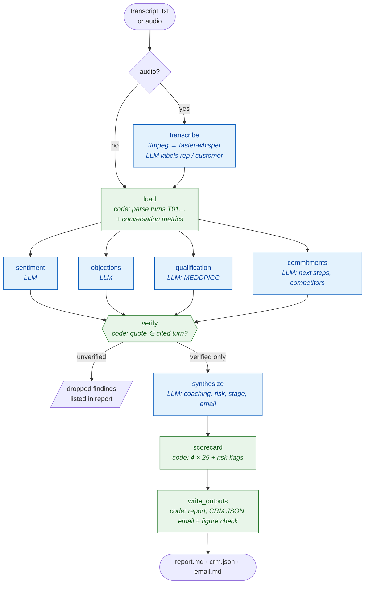
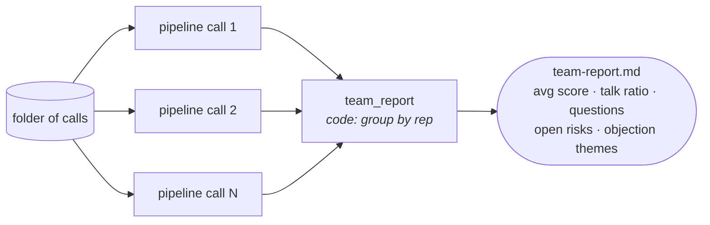

# CallCoach — sales call intelligence with evidence-checked findings

> Turns a sales call (transcript or audio) into a coaching scorecard, MEDDPICC qualification, an objection review,
> a CRM update and a follow-up email draft. Every finding quotes the line it came from, and code checks it.

**Stack:** LangGraph parallel fan-out/fan-in · Pydantic structured outputs · local faster-whisper + ffmpeg · Claude or Ollama

---

## The problem

Sales managers can only listen to a small share of their team's calls. LLM call summaries help, but they:

- **guess** things that can be measured (who talked more, how many questions the rep asked),
- **invent** objections, competitors or commitments that sound right but were never said,
- produce **scores that are not comparable** across calls or reps.

CallCoach **measures** what can be measured, **verifies** every LLM finding against the transcript, and **computes**
the score from a fixed rubric.

## Features

| Feature | How it works |
|---|---|
| Measured conversation metrics | Talk ratio, rep and customer questions, longest rep monologue, duration — computed from the transcript |
| Four parallel analysers | Sentiment arc, objections and how each was handled, MEDDPICC qualification, next steps and competitors |
| Quote verification | Every finding cites a turn id and a quote; code checks the quote is in **that** turn. Failed findings are flagged in the report and kept out of the scorecard, the CRM update and the coaching synthesis |
| Deterministic scorecard | Four components × 25 points (discovery, objection handling, talk balance, next steps) |
| Risk flags | Unresolved objections, no economic buyer, no champion, no dated next step |
| CRM update | JSON with recommended stage, risk, verified next steps, competitors, MEDDPICC snapshot |
| Follow-up email | Drafted from verified findings; numbers and dates in the email that were never said on the call are flagged "check before sending" |
| Team report | `batch` mode: per-rep averages, calls ranked by score, objection themes |
| Local audio | ffmpeg decode → faster-whisper → LLM labels each segment rep or customer |

## Architecture

### Pipeline



The four analysers run in the same LangGraph superstep; `verify` waits for all of them (`add_edge([...], "verify")`).

### Batch mode



### Scorecard

| Component (0–25) | Formula |
|---|---|
| Discovery | 12.5 × min(rep questions / 6, 1) + 12.5 × MEDDPICC coverage (confirmed = 1, partial = 0.5) |
| Objection handling | 25 × mean over verified objections (well 1.0, partly 0.6, poorly 0.2, not addressed 0); 25 if none |
| Talk balance | 25 when rep talk ratio is 40–60%, minus 1 point per percentage point outside; −5 if a monologue > 45 s |
| Next steps | 15 for a dated rep commitment (5 if undated) + 10 for a customer commitment |

### Transcript format

```text
---
call_id: CALL-1031
date: 2026-10-08
rep: Priya Shah
account: Sunpeak Grocers
stage: Proposal
speakers: {Priya: rep, Dana: customer, Marco: customer}
---
[00:00] Priya: Thanks for making time, Dana and Marco. ...
[00:12] Dana: We want to know if forty more Courier C3 robots can be live in Round Rock by March ...
```

### CRM update (example)

```json
{
  "account": "Halden Logistics",
  "current_stage": "Renewal",
  "recommended_stage": "Negotiation",
  "deal_risk": "high",
  "risk_flags": ["3 objection(s) left unresolved", "economic buyer not identified", "no dated next step"],
  "next_steps": [{"owner": "rep", "action": "check on service credit with finance", "due": ""}],
  "competitors": ["Kinexa"],
  "meddpicc": {"economic_buyer": {"status": "unknown", "detail": ""}, "...": "..."},
  "coaching_score": 32
}
```

## Results on the sample calls

| Call | Rep | What happens | Score | Risk |
|---|---|---|---|---|
| Sunpeak Grocers expansion | Priya Shah | Strong discovery, names the CFO and board date, handles the battery incident and a competitor quote, dated next steps on both sides | 94–100 | medium |
| Marlow Foods discovery | Priya Shah | Good pain discovery, budget timing found, decision criteria not explored | 76–79 | medium |
| Halden Logistics renewal | Ravi Menon | Opens with a 58-second feature pitch, no questions, deflects the outage and the missing credit, competitor unanswered | 32–38 | high |

Ranges are across four runs. Example outputs: [report](../docs/examples/callcoach-CALL-1029-report.md),
[CRM JSON](../docs/examples/callcoach-CALL-1029-crm.json), [email](../docs/examples/callcoach-CALL-1029-followup-email.md),
[team report](../docs/examples/callcoach-team-report.md).

## Usage

```bash
uv run python -m callcoach analyze callcoach/sample_calls/halden_renewal.txt
uv run python -m callcoach batch callcoach/sample_calls --workers 3
uv sync --extra audio
uv run python -m callcoach transcribe call.m4a --rep "Priya Shah" --account "Acme" --whisper-model base
```

## Files

| File | Purpose |
|---|---|
| [`pipeline.py`](pipeline.py) | Graph, analysers, verification, scorecard, risk flags, figure check, CRM and report rendering, team report |
| [`transcript.py`](transcript.py) | Transcript parsing and conversation metrics |
| [`transcribe.py`](transcribe.py) | Audio → transcript (ffmpeg + faster-whisper + LLM speaker roles) |
| [`sample_calls/`](sample_calls/) | Three fictional calls |

## Limitations and next steps

- The email figure check catches invented numbers and dates, not invented promises built from numbers that were said (e.g. offering a "4-hour SLA" because the customer mentioned a competitor's). The rep still reviews every draft.
- Speaker roles from audio come from content, not voice diarization; check them in the written transcript.
- Next: track one account's deal health across several calls.
