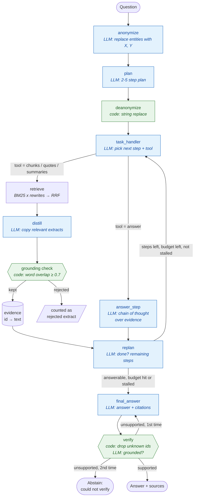
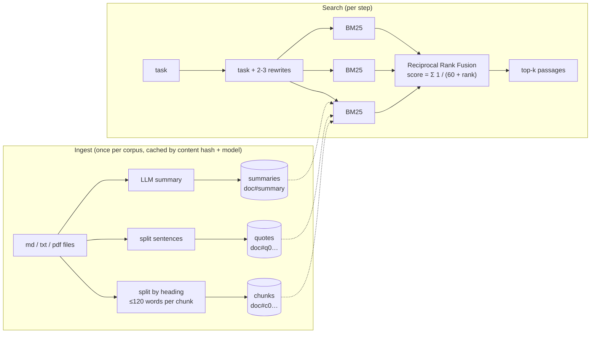

# CiteSure — controllable RAG with verified citations

> Answers multi-step questions from your own documents. Every fact cites the passage it came from, code checks
> each citation, and when the documents don't contain the answer, CiteSure says so instead of guessing.

**Stack:** LangGraph state machine · BM25 + Reciprocal Rank Fusion · Pydantic structured outputs · Claude or Ollama

---

## The problem

Plain "retrieve top-k chunks and answer" RAG fails on questions like:

> *Which account manager owns the customer whose outage was caused by firmware 4.2, and when does that customer's contract renew?*

No single chunk answers this. You need three hops (incident log → customer list → contracts), and each hop
depends on the one before. Plain RAG also tends to fill gaps with plausible-sounding facts the documents never
stated. CiteSure handles the multi-hop part with a **plan → execute → re-plan** loop. It handles invented facts by
**checking evidence in code at every step**.

## Features

| Feature | How it works |
|---|---|
| Multi-hop planning | Builds a 2–5 step plan, executes one step at a time and re-plans after each one |
| Anonymised planning | Named entities are replaced with X, Y… before planning, so the plan comes from the data, not from what the model already "knows" about famous names. Names are swapped back with a plain string replace in code |
| Three retrieval stores | `chunks` (heading-aware passages), `quotes` (single sentences), `summaries` (one per document, cached) |
| Hybrid-style ranking | Each step is searched in 2–3 rewrites; BM25 rankings are merged with Reciprocal Rank Fusion |
| Extract grounding | The LLM copies relevant text out of retrieved passages; code rejects any extract whose words are not in its source passage (≥ 70% overlap) |
| Citation checking | Answers must cite passage ids; ids that were never retrieved are removed |
| Answer verification | A final check confirms the answer is supported; if not, one rewrite, then an honest abstain |
| Step budget | `--max-steps` stops runaway loops |
| Stall detection | Two lookups in a row that add no new evidence end the search; the agent answers from what it has (or abstains) instead of repeating itself |
| Evidence merging | Several facts copied from one passage are merged under that passage id, so a later lookup never overwrites an earlier fact |
| Evaluation harness | Golden questions → accuracy (LLM judge), source recall (code), abstain accuracy → markdown report |
| Any corpus | Folder of `.md`, `.txt` or `.pdf` files |

## Architecture

### Agent graph



Green nodes are deterministic code; blue nodes call the LLM. Every LLM call returns a typed Pydantic object.

### Ingestion and retrieval



### Why the checks are in code

| Risk | LLM-only approach | CiteSure |
|---|---|---|
| Extract adds a fact not in the passage | Ask another LLM "is this grounded?" | Word-overlap check against the exact source passage — free, deterministic, unit-tested |
| Answer cites a passage that was never retrieved | Usually unnoticed | Citation ids checked against the evidence dictionary |
| Plan names drift during de-anonymisation | LLM rewrites the plan | `str.replace` — cannot hallucinate |
| Loop never terminates | Hope | Step budget, stall detection (no new evidence twice) and LangGraph recursion limit |

## State

| Field | Type | Written by | Meaning |
|---|---|---|---|
| `question` | str | caller | Original question |
| `anonymized` | `Anonymized` | anonymize | Question with X/Y placeholders + entity map |
| `plan` | list[str] | plan, deanonymize, replan | Remaining steps |
| `decision` | `TaskDecision` | task_handler | Next step, tool, search rewrites |
| `evidence` | dict[id → {id, text}] | retrieve | Grounded extracts, keyed by passage id |
| `past_steps` | list[str] | retrieve, answer_step | Log of what each step found |
| `steps_taken` / `max_steps` | int | retrieve, answer_step / caller | Budget |
| `rejected_extracts` | int | retrieve | Extracts that failed the grounding check |
| `stalled` | int | retrieve, answer_step | Consecutive lookups that added no new evidence |
| `final` | `FinalAnswer` | final_answer, verify | Answer, citations, confidence, abstain flag |
| `verify_attempts` / `verify_feedback` | int / str | verify | Rewrite loop control |

## Results

Measured on the bundled 6-question golden set (fictional company, facts spread across 6 documents), with
`gpt-oss:120b-cloud` via Ollama:

| Metric | Run 1 | Run 2 |
|---|---|---|
| Answer accuracy (LLM judge vs reference) | **6 / 6** | **5 / 6** |
| Source recall (expected documents cited) | 100% | 83% |
| Abstain accuracy (declines the unanswerable revenue question, answers the rest) | 100% | 83% |
| Average steps per question | 2.2 | 2.3 |

The run-2 miss was an over-cautious abstain on question 5, a "no" answer that needs reasoning over two documents.
It never produced a wrong fact.

**Bugs the evaluation found, now fixed and covered by regression tests:**

1. *Facts overwriting each other.* The notice period and the renewal date for one customer sit in the same
   passage. Evidence was stored one extract per passage, so each lookup replaced the other fact and the agent
   alternated between them until the budget ran out. Extracts from one passage are now merged.
2. *Repeated fruitless lookups.* Asked for "Halden's monthly FleetOS fee", which no document states, the agent
   repeated the same search four times. Stall detection now ends the search after two lookups with no new
   evidence, and the re-planner is told not to repeat them.

Full report: [docs/examples/citesure-eval.md](../docs/examples/citesure-eval.md).

Example run:

```text
plan: Search for outages caused by firmware 4.2 | Find the account manager for that customer | Find the renewal date
step 1: chunks — outages caused by firmware 4.2        kept 1 extract(s), rejected 0 ungrounded
step 2: chunks — account manager of Halden Logistics    kept 1 extract(s), rejected 0 ungrounded
step 3: chunks — renewal date for Halden Logistics      kept 1 extract(s), rejected 0 ungrounded

The account manager is Ravi Menon, and the contract renews on 2026-11-30.
Sources: incidents#c0, customers#c0, contracts#c1
Confidence: high · steps: 3 · rejected extracts: 0
```

## Usage

```bash
uv run python -m citesure ask "Who does the account manager for Kestrel Pharma report to?"
uv run python -m citesure ask --corpus ~/docs/contracts --max-steps 8 "your question"
uv run python -m citesure eval --golden citesure/golden.yaml --report runs/citesure-eval.md
```

Each `ask` writes a JSONL trace (node, duration, keys changed) to `runs/citesure-trace.jsonl`.

## Files

| File | Purpose |
|---|---|
| [`agent.py`](agent.py) | Graph, nodes, schemas, verification loop |
| [`index.py`](index.py) | Loading, chunking, BM25, RRF, summary cache, `support_ratio` grounding check |
| [`evaluate.py`](evaluate.py) | Golden-set runner and report |
| [`golden.yaml`](golden.yaml) | Evaluation questions with reference answers and expected sources |
| [`sample_corpus/`](sample_corpus/) | Fictional company documents |

## Limitations and next steps

- BM25 matches words, not meaning; adding dense embeddings as a fourth ranking in the fusion would help paraphrased questions.
- The word-overlap check catches invented facts but not a wrong *selection* of true sentences; the final LLM verification covers that.
- The golden set is small; it is a regression gate, not a benchmark.
