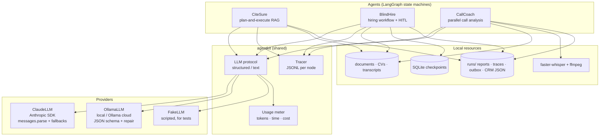
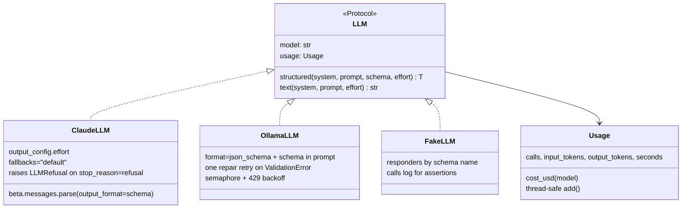

# Architecture

This document covers what the three agents share: the LLM layer, the "LLM proposes, code verifies" pattern,
orchestration, state, testing, and the trade-offs behind each choice. Each project's own README covers its graph in
detail: [CiteSure](../citesure/README.md) · [BlindHire](../blindhire/README.md) · [CallCoach](../callcoach/README.md).

## System overview



## Design principle: the LLM proposes, code verifies

Each agent separates **judgement** (what the LLM is good at) from **checking and arithmetic** (what code does
reliably). The pattern repeats across all three:

| | CiteSure | BlindHire | CallCoach |
|---|---|---|---|
| LLM proposes | Extracts and an answer with citations | Rubric scores with CV quotes | Findings with turn ids and quotes |
| Code verifies | Extract words ⊆ source passage; cited ids were retrieved | Quote is in the anonymised CV; must-haves backed by a quote | Quote is in the cited turn; email figures were said on the call |
| Code decides | Step budget, abstain | Weighted score, knockouts, shortlist | Metrics, scorecard, risk flags |
| On failure | Extract rejected; answer rewritten once, then abstain | Score capped at 2, must-have marked not met | Finding dropped from score, CRM and synthesis; listed in report |

The checks are deliberately simple (substring and word-overlap tests). They run in microseconds, are fully
unit-tested, and catch the most damaging failure, invented content, without a second LLM call.

## LLM layer (`agentkit/llm.py`)



- **Typed outputs only.** Every node asks for a Pydantic model, so no response is parsed with regexes (the
  original HR project parsed `Overall Score: 7.5` out of free text).
- **Provider choice is one environment variable** (`AGENT_LLM_PROVIDER`); graphs never import a provider.
- **Claude** uses structured outputs (`messages.parse`), `output_config.effort` per call (low for extraction,
  medium for reasoning), and server-side refusal fallbacks. A refusal raises `LLMRefusal` instead of returning
  an empty object.
- **Ollama** puts the JSON schema in the system prompt as well as in `format` (some cloud models ignore `format`),
  retries once with the validation error, caps concurrency, and backs off on HTTP 429.
- **Usage metering** is thread-safe because LangGraph runs parallel branches in threads.

## Orchestration patterns (LangGraph)

| Pattern | Where | Mechanism |
|---|---|---|
| Plan → execute → re-plan loop | CiteSure | Conditional edges `replan → task_handler / final_answer`, step budget in state |
| Self-correction loop | CiteSure | `verify → final_answer` with an attempt counter |
| Map (dynamic fan-out) | BlindHire | `Send("score_cv", …)` per CV; results merged with an `operator.add` reducer |
| Static fan-out / fan-in | CallCoach | Four edges from `load`; `add_edge([four analysers], "verify")` joins them |
| Human-in-the-loop | BlindHire | `interrupt(payload)` inside review nodes; resumed with `Command(resume=…)` |
| Durable state | BlindHire | `SqliteSaver` checkpointer; thread id = run id; `resume` reads pending interrupts |

Review nodes contain **only** the `interrupt()` call and a state update. LangGraph re-runs a node from the top when
it resumes, so an LLM call placed before `interrupt()` would run twice.

## State design

- State is a `TypedDict`; values that must survive checkpointing (BlindHire) are plain dicts and lists, not Pydantic
  objects, so the SQLite serializer never has to import application classes.
- Parallel branches write **different keys** (CallCoach) or use a **reducer** (BlindHire's `scores`), so there are
  no write conflicts.
- Data minimisation: BlindHire's scoring branch receives `{id, blind_text}` only, not the full candidate record.

## Observability

`Tracer.node(name)` wraps each node and appends one JSON line per execution:

```json
{"t": 1760772412.31, "event": "node", "node": "retrieve", "ms": 2140, "updated": ["evidence", "past_steps", "rejected_extracts", "steps_taken"]}
```

Errors (including LangGraph interrupts, which are exceptions) are logged with the node name and re-raised. Every
CLI run ends with a usage line: calls, input/output tokens, model time and, for Claude, an estimated cost.

## Testing strategy

| Layer | What is tested | How |
|---|---|---|
| Pure functions | BM25, RRF, chunking, `support_ratio`, redaction, rubric scoring, ranking, transcript parsing, metrics, scorecard, figure check | Plain pytest |
| Graph wiring | Routing, loops, budgets, interrupts, resume, fan-out | Full graphs with `FakeLLM` responders that inspect the prompt |
| Safety properties | No candidate name reaches the scorer; invented extracts and quotes never reach answers, CRM or synthesis; unknown citations dropped | Assertions on `FakeLLM.calls` and outputs |
| Quality | Answer accuracy, source recall, abstain accuracy | `citesure eval` against a golden set with a real model |

All 18 tests run offline in under a second and run in CI on every push.

## Security and privacy

- No credentials in code; Claude reads `ANTHROPIC_API_KEY` from the environment.
- BlindHire never sends messages; it writes drafts to an outbox.
- All sample people, companies, phone numbers (555-01xx) and emails (`example.com`) are fictional.
- Audio transcription runs locally; no audio leaves the machine.

## Technology choices

| Choice | Why | Alternative considered |
|---|---|---|
| LangGraph | Explicit state machine, conditional edges, `Send`, interrupts and checkpointing in one library | CrewAI (used by the original CallCoach source) — less control over flow and state |
| BM25 + RRF | No embedding service needed, deterministic, strong on small corpora with exact names and numbers | FAISS + embeddings — better for paraphrase; a planned addition |
| Pydantic structured outputs | One schema serves validation, prompting and documentation | JSON mode + manual parsing |
| SQLite checkpointer | Zero-setup persistence for resumable reviews | Postgres checkpointer for multi-user deployments |
| faster-whisper (local) | No per-minute API cost, audio stays local | Hosted Whisper API |
| uv | Fast, reproducible installs with a lockfile | pip + requirements.txt |
