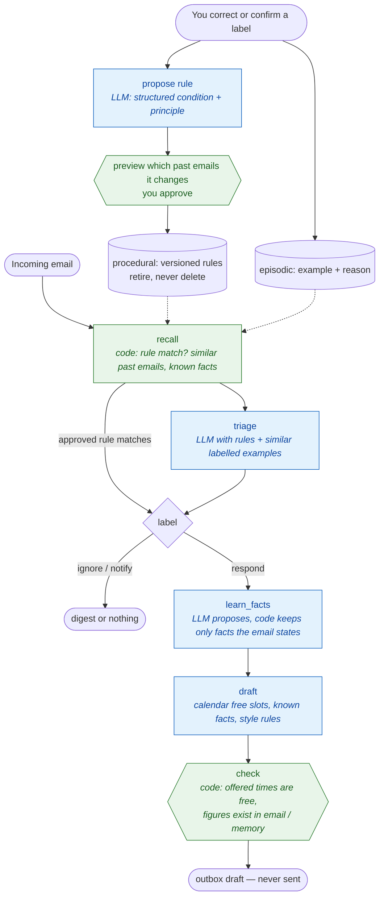

# InboxMind — email assistant that learns from your corrections

> Triages your inbox into ignore / notify / respond, drafts replies, and gets better as you correct it. What it
> learns is stored in SQLite, shown to you before it takes effect, and applied by code so the preference is guaranteed.

**Rebuilt from** GenAI_Agents #32 (Memory-Enhanced Email Agent with LangMem), which kept memories in RAM, let an
optimiser rewrite its prompts freely, and sent mail through a tool.

## Architecture



## Three memories

| Memory | Stores | Used for |
|---|---|---|
| Semantic | Facts about people and accounts, each linked to the email that stated it | Drafting with context |
| Episodic | Past emails with the label you confirmed and why | Few-shot examples chosen by BM25 similarity |
| Procedural | Approved rules: a structured condition (sender, domain, subject, body) plus a one-line principle | Code applies the condition before the LLM; the principle guides similar emails |

## Measured learning

Six training corrections, eight held-out emails the agent is never corrected on (`gpt-oss:120b-cloud`):

| | Accuracy |
|---|---|
| Before learning (empty memory) | **50%** |
| After learning | **100%** |

Report with rules, facts and drafts: [docs/examples/inboxmind-learning-report.md](../docs/examples/inboxmind-learning-report.md).

```bash
uv run python -m inboxmind learn-demo
uv run python -m inboxmind feedback --email T-04 --label notify --note "Failed builds on main matter"
uv run python -m inboxmind rules --all          # add --retire 3 to switch a rule off
```

Files: [`agent.py`](agent.py) graph, learning, checks · [`memory.py`](memory.py) SQLite stores · [`sample/`](sample/) inbox, calendar, profile.
