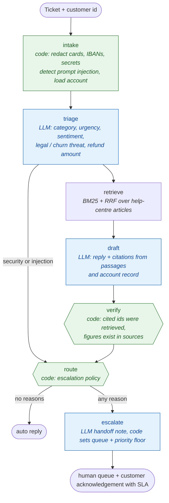

# ResolveDesk — support agent that answers from the help centre or hands off to a human

> Answers support tickets from a knowledge base and the customer's account record with checked citations. Anything
> risky, uncovered or unverified goes to the right human queue with a ready-written handoff.

**Rebuilt from** GenAI_Agents #9 (Customer Support Agent), which classified a query, wrote a generic model-knowledge
reply and escalated only on negative sentiment.

## Architecture



## What changed from the original

| Original | ResolveDesk |
|---|---|
| Model-knowledge answers | Answers only from KB passages + account record; citations checked |
| Card numbers and secrets sent to the LLM | Redacted in code first (Luhn-checked cards, IBAN, CVV, passwords) |
| Escalate on negative sentiment only | Written policy: security, critical urgency, legal/churn threat, very negative sentiment, refund over USD 500, injection, no KB coverage, low confidence, failed verification |
| Escalation = a canned sentence | Handoff note (summary, context, wants, recommended action), queue, priority (policy can raise, never lower) and an SLA-aware customer message |
| No protection from hostile text | Ticket wrapped as data; injection and security tickets never reach the drafting model |

## Results (10 sample tickets, `gpt-oss:120b-cloud`)

23/23 checks passed: 5 tickets answered automatically with the right article (password reset, offline robot, duplicate
add-on charge, card update, SLA credit), 5 escalated for the right reason (refund over limit, legal threat, security
incident, prompt injection, no KB coverage). See [docs/examples/resolvedesk-batch-report.md](../docs/examples/resolvedesk-batch-report.md).

```bash
uv run python -m resolvedesk ticket --customer C-1003 "I forgot my password and the link expired"
uv run python -m resolvedesk batch
```

Files: [`agent.py`](agent.py) graph, policy, verification · [`guard.py`](guard.py) input guard · [`sample/`](sample/) KB, accounts, tickets.
